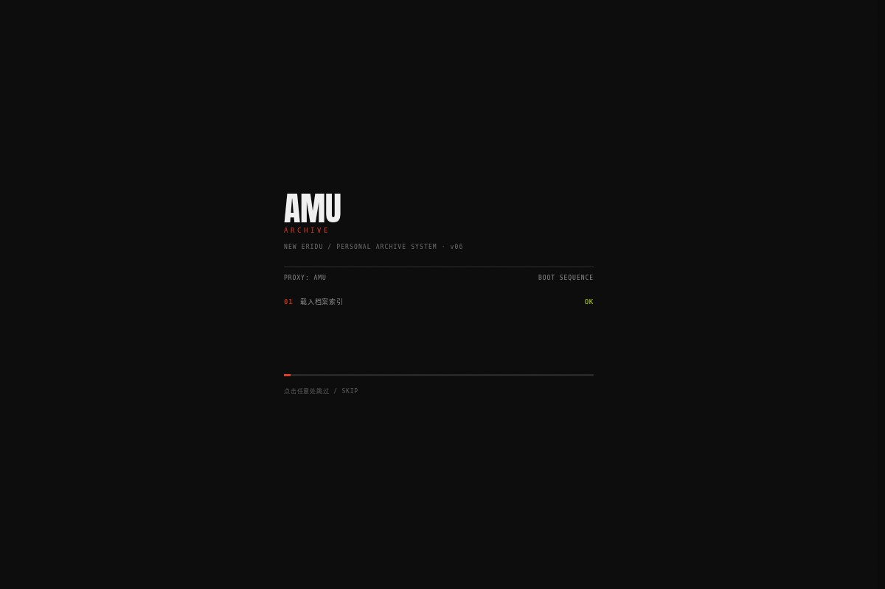
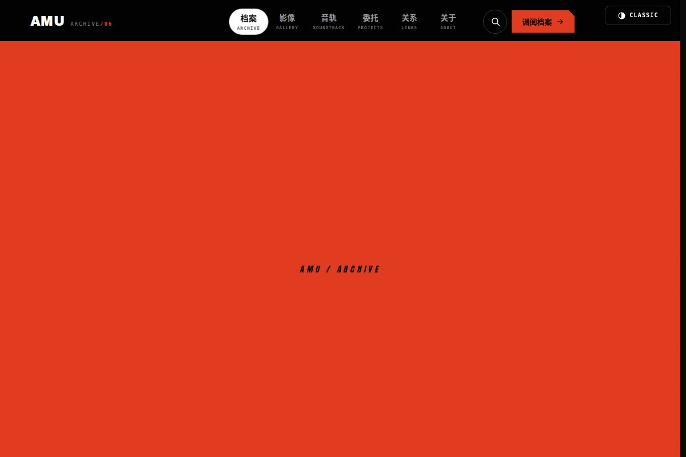

# 动效兼容：Windows 关闭“动画效果”

Windows 关闭“动画效果”（设置 → 辅助功能 → 视觉效果 → 动画效果）后，浏览器会一直上报
`prefers-reduced-motion: reduce`。站点之前对这条媒体查询做了较广的降级，导致不少动效在站长自己的
Windows 机器上直接不可见。按站长要求，站点动效统一保留，不再因系统设置跳过。

## 审计与修改

| 动效 | 位置 | 修改前（reduce） | 修改后 |
|---|---|---|---|
| ZZZ 首屏 boot 帘幕 | `zzz/scripts/build.mjs`、`zzz/assets/js/site.js`、`zzz/assets/css/site.css` | 不设 `data-boot`；`site.js` 直接 finish；CSS `.boot{display:none}` | 首访始终播放 boot，点击/空格/Esc 仍可跳过 |
| ZZZ 页面 wipe 转场 | `zzz/assets/js/site.js`（wipe 监听） | `!reduced()` 才绑定，点击直接跳转 | 始终绑定；360ms 橙色 wipe 后导航（主题切换按钮仍由圆形接管） |
| ZZZ 滚动 reveal | `zzz/assets/js/site.js`、`site.css` | 不创建 IntersectionObserver，`.reveal` 被强制终态 | 始终创建；卡片淡入/上移 |
| ZZZ 桌面 ghost 视差 | `zzz/assets/js/site.js` | `!reduced()` 才启用 | 始终启用（≥900px） |
| ZZZ pulse / hover / hero 位移 / 平滑滚动 | `zzz/assets/css/site.css` 全局 reduce 块 | 所有动画/过渡压到 0.01ms，`.boot` 隐藏 | 删除全局降级块，恢复原动效 |
| 经典站路由加载环 | `src/app.vue` | `animation: none` | 始终旋转（0.7s） |
| 经典站首页热力图格子 | `src/components/home/ActivityHeatmap.vue` | `transition: none` | 保留 0.1s 过渡 |
| 主题切换圆扩散 | `useThemeSwitch.ts` / arrival 脚本 | 之前被 reduce 跳过 | 已在 PR #5 改为始终播放 |
| 经典站首屏帘幕 | `index.html` | 本来就故意不降级 | 不变 |
| Vuetify 内置微过渡（snackbar/dialog/field 等） | Vuetify 自身 CSS | 仍遵循 reduce | 本次不动；页面级自定义动效已覆盖 |

## 取舍

这是站点主人明确要求的取舍：个人站点的视觉动效优先于系统“减少动态效果”设置。启动帘幕原本就是
这么处理的（见 `src/content/posts/boot-splash-and-meteor-halo.md`），现在把同一策略扩展到其余站点动效。
如果以后要照顾访客，可以加一个站内动效开关，而不是依赖系统媒体查询。

## 证据（`reducedMotion: reduce`）

Before = 线上 `master` @ `31d4314`（PR #6 部署版本）；After = 本次分支本地构建。

| | Before | After |
|---|---|---|
| ZZZ 首屏 boot |  |  |
| ZZZ 页面 wipe |  |  |

复测（Playwright，`reducedMotion: reduce`）：

- boot：`data-boot=on`、`html.booting`、`#boot` 可见；约 2.6s 后移除。
- wipe：点击后 `.wipe.is-on`，`visibility: visible`，transform 从 102% 滑到 0；360ms 后导航。
- reveal：滚动后 `.reveal` 9 个，`.is-in` 6 个；ghost transform `translate3d(0,108px,0)`；`.pulse` animation `pulse`。
- 经典站：`.route-loading__mark` animation `route-loading-spin` 0.7s；`.ah-cell` transition 0.1s；首页 hero animation `home-rise`。
